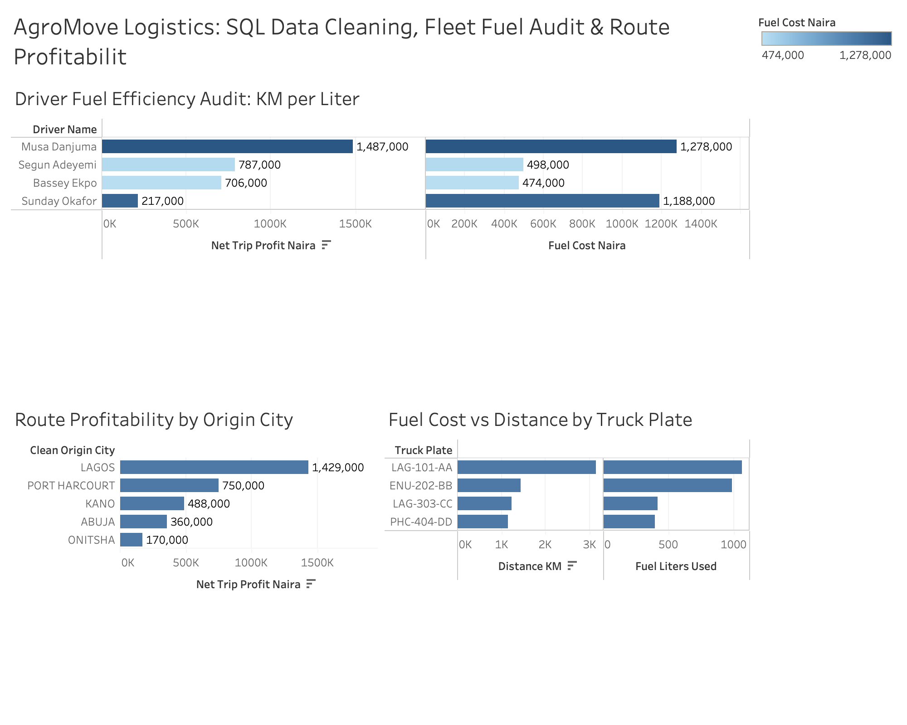

# 🚚 AgroMove Logistics Nigeria: SQL Data Cleaning & Fleet Fuel Theft Audit
**Tools Used:** MySQL (`SELECT DISTINCT` Deduplication, `UPPER(TRIM())` Text Standardization, `COALESCE()` Null Handling, Fuel Efficiency Math) | Tableau (Fleet Operations Dashboard)

## 📌 Executive Summary
AgroMove Logistics operates heavy-duty haulage trucks across major Nigerian trade corridors (**Lagos, Kano, Onitsha, Abuja, and Port Harcourt**). The company's raw ERP trip logs (`Raw_Fleet_Logs`) suffered from severe data quality issues—including duplicate trip entries, inconsistent city text formatting, and missing (`NULL`) maintenance records—masking a major fuel cost leak.

I built an automated **SQL Data Cleaning Pipeline** to standardize the dataset into an analytics-ready table (`Clean_Fleet_Trips`) and conducted a fleet efficiency audit that uncovered a critical **diesel overconsumption/siphoning anomaly**.

---

## 📊 Executive Fleet & Route Profitability Dashboard (Tableau)

---

## 🧹 Step 1: SQL Data Cleaning & Standardization Pipeline
Before running financial calculations, my data quality audit (`Query 1`) identified **4 critical data integrity issues** across the raw 12-row log dump, which were resolved programmatically in SQL (`Query 2`):
1. **Duplicate Record Removal (`SELECT DISTINCT`):** Identified and removed **2 duplicate trip records** (`TRP01` and `TRP05`), reducing inflated gross revenue by **₦1,450,000**.
2. **Text & Whitespace Standardization (`UPPER(TRIM())`):** Cleaned inconsistent origin/destination strings (e.g., `'  lagos '`, `'LAGOS'`, `'onitsha'`, `'kano  '`) into standardized uppercase city names so grouping and Tableau filters function accurately.
3. **Missing Value Imputation (`COALESCE()`):** Found **4 records with `NULL` values** in `Maintenance_Cost_Naira` (which previously caused `Net_Profit` arithmetic to return `NULL`). Applied `COALESCE(Maintenance_Cost_Naira, 0)` to safely impute zero-cost maintenance trips.

---

## 🔍 Step 2: Fleet Fuel Efficiency & Profitability Findings

### 1. Diesel Siphoning / Overconsumption Anomaly (`Truck ENU-202-BB`)
- By calculating **`ROUND(SUM(Distance_KM) / SUM(Fuel_Liters_Used), 2) AS KM_Per_Liter_Efficiency`**, I discovered a severe outlier:
  - **Musa Danjuma (`LAG-101-AA`):** `2.96 KM/Liter` (3,150 KM driven on 1,065 L) $\rightarrow$ **₦1,477,000 Net Profit** (`100% On_Time`)
  - **Segun Adeyemi (`LAG-303-CC`):** `2.99 KM/Liter` (1,240 KM driven on 415 L) $\rightarrow$ **₦787,000 Net Profit** (`100% On_Time`)
  - **Bassey Ekpo (`PHC-404-DD`):** `2.94 KM/Liter` (1,160 KM driven on 395 L) $\rightarrow$ **₦706,000 Net Profit** (`100% On_Time`)
  - **🚨 Sunday Okafor (`ENU-202-BB`):** **`1.45 KM/Liter`** (1,440 KM driven on **990 Liters**!) $\rightarrow$ Only **₦217,000 Net Profit** (`100% Delayed`).
- **Root Cause Impact:** Despite driving less than half the distance of the Kano truck, `ENU-202-BB` consumed **double the standard diesel per kilometer**, costing AgroMove an estimated **~500 liters (₦600,000) in excess/unaccounted fuel** across just 3 Onitsha–Lagos trips.

---

## 💡 Strategic Operations Recommendations
1. **Immediate Mechanical & Fuel Audit on `ENU-202-BB`:** Install fuel-level telematics sensors and conduct an injector/fuel-line inspection on `ENU-202-BB` (assigned to Sunday Okafor) to stop the **₦200,000/trip diesel leak**.
2. **Database Validation Constraints:** Enforce `UNIQUE` constraints on `Trip_ID`, dropdown validation on `Origin_City`, and `DEFAULT 0` on `Maintenance_Cost_Naira` at the data-entry level to prevent future dirty data.
